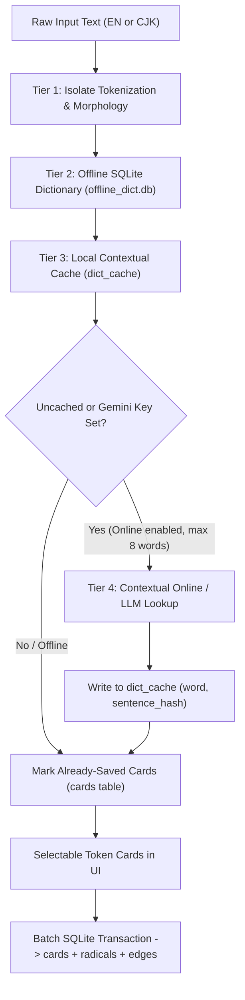

# VocabAnki — NLP Pipeline Architecture

This document explains how the **Tách từ NLP** (NLP Text Extractor) works in VocabAnki, from pasting raw text to saving FSRS flashcards with US/UK IPA pronunciations, surface-form Cloze deletions, and morpheme/radical links.

---

## 1. High-Level Multi-Tier Hybrid Pipeline

VocabAnki uses an **offline-first, 4-tier hybrid NLP pipeline** designed to run cleanly on both **Android** and **Flutter Web (SQLite WASM)** without blocking the UI thread:

---

## 2. Clean Architecture Layers

| Layer | File | Responsibility |
| :--- | :--- | :--- |
| **Presentation (UI)** | `lib/features/nlp_extractor/presentation/pages/nlp_extractor_page.dart` | Text input, Quick Paste/Clear, mode toggle (`EN-VI` / `CJK`), target deck selector, granular `.select()` token list, and error banner. |
| **Presentation (State)** | `lib/features/nlp_extractor/presentation/providers/nlp_extractor_provider.dart` | `NlpExtractorNotifier` manages `isAnalyzing`, `isSaving`, `tokens`, `selectedWords`, `lastElapsedMs`, and `try/catch` safety guards. |
| **Domain (Use Cases)** | `lib/features/nlp_extractor/domain/usecases/analyze_text_usecase.dart` `create_cards_from_tokens_usecase.dart` | Orchestrates text analysis and batch card creation. |
| **Data (Repository)** | `lib/features/nlp_extractor/data/repositories/nlp_extractor_repository_impl.dart` | Checks which extracted words already exist in `cards`, and persists selected tokens + morphemes inside a single SQLite transaction (with deck FK validation). |
| **Data (Engine)** | `lib/features/nlp_extractor/data/datasources/nlp_analyzer_datasource.dart` | Implements the 4-tier hybrid NLP engine (`HybridNlpAnalyzerDataSourceImpl`). |
| **Core Utilities** | `lib/core/database/offline_dictionary_database.dart` `lib/core/utils/cloze_masker.dart` | Read-only 205k-word SQLite dictionary loader and surface-form Cloze deletion masker. |

---

## 3. Step-by-Step Walkthrough

### Tier 1 — Background Isolate Tokenization, Lemmatization & Morphology
Executed via Flutter's `compute(_tokenizeAndDecomposeInIsolate, payload)` using the lightweight `assets/nlp/nlp_bundle.json` bundle (~208 KB):

1. **Sentence Splitting:**
   Splits input text on sentence boundaries (`(?<=[.!?。\n])\s+`) so every extracted token retains its exact source sentence for contextual learning.
2. **Tokenization & Filtering:**
   - **EN-VI mode:** Matches alphabetic tokens `[A-Za-z]{3,}`, lowercases them, filters common English stop words (`the`, `and`, `for`, `would`, etc.), deduplicates by surface word, and caps at **40 tokens per pass**.
   - **CJK mode:** Matches Hanzi/Kanji chunks `[\u4e00-\u9fff]{1,4}` (capped at 30) and decomposes characters into radicals/pinyin hints.
3. **Lemmatization (`_lemmatizeWord`):**
   - Checks the **5,500+ WordNet irregular lemma map** first (e.g., `ran -> run`, `phenomena -> phenomenon`, `better -> good`).
   - Falls back to rule-based inflection stripping (`-ies -> -y`, `-ied -> -y`, `-ves -> -f/-fe`, `-ing`, `-ed`, `-es`, `-s`), validating candidates against the offline dictionary.
4. **Morphological Root Decomposition (`_decomposeMorphology`):**
   Decomposes each word into **Greek/Latin prefixes, roots, and suffixes** (e.g., `inspect -> in- + -spect-`, `transport -> trans- + -port-`, `portable -> -port- + -able`).
5. **Part of Speech (POS) & Fallback Synthesis:**
   Infers POS (`noun`, `verb`, `adj`, `adv`, `vocab`) from suffixes when missing, generates a fallback rule-based G2P IPA (`_fallbackG2pIpa`), and synthesizes a morpheme-based hint if no dictionary entry is found yet.
6. **Surface-Form Cloze Masking (`ClozeMasker.maskSentence`):**
   Masks the exact **surface form** (and any inflected/irregular variant of the lemma) in the source sentence with `[...]` — for example, even if the lemma is `run`, the sentence *"She was running fast"* becomes *"She was [...] fast"*.

---

### Tier 2 — Dedicated Offline SQLite Dictionary (`assets/nlp/offline_dict.db`)
Managed by `OfflineDictionaryDatabase`:

- **Asset Size & Content:** ~18.7 MB pre-built SQLite database (`tool/build_offline_dict_sqlite.py`) containing **205,000+ English headwords**, **104,700+ EN-VI definitions** (CC BY-SA 4.0), **US (`ipa_us`) & UK (`ipa_uk`) IPA** from Open Dict Data, and irregular lemmas.
- **Lazy Initialization & Indexed Lookup:**
  Materialized once on first access via `databaseFactory.writeDatabaseBytes(...)` and opened read-only. Instead of loading 200k entries into RAM, it runs chunked primary-key queries (`WHERE word IN (?, ?, ...)` in chunks of 200) for both `surfaceWord` and `lemma`.
- **Reliability Safeguards (Web & Mobile):**
  Uses a shared `_openingFuture` concurrency guard plus explicit timeouts (`12s` on Web, `8s` on native for initial copy; `4s` per query) so if IndexedDB/WASM initialization ever stalls, the pipeline degrades gracefully to Tier 1 + Tier 3/4 instead of hanging.

---

### Tier 3 — Contextual Local SQLite Cache (`dict_cache`)
Before making any network request, `HybridNlpAnalyzerDataSourceImpl` queries the local `dict_cache` table in `vocab_anki_graph.db`:

- **Composite Key:** `(word, sentence_hash)` where `sentence_hash` is the first 12 hex characters of the MD5 hash of the normalized source sentence.
- **Why sentence-keyed?** Polysemous words (e.g., *"bank"* of a river vs. *"bank"* account) can store distinct context-specific Vietnamese meanings per sentence, with fallback to `(word, '')`.

---

### Tier 4 — Context-Aware Online / LLM Enrichment
Triggered only when `enableOnlineLookup` is enabled in Settings, and only for tokens that are not in the offline bundle (or when a **Gemini API key** is configured for contextual disambiguation), capped at **8 words per analysis**:

1. **Pronunciation & Audio:** Queries `api.dictionaryapi.dev` for US/UK IPA and audio URLs.
2. **Contextual Meaning:**
   - **If Gemini API Key is set:** Sends the word, lemma, full sentence, and offline glossary/morpheme hint to `gemini-2.0-flash` requesting strict JSON `{"pos": "...", "meaning": "..."}`.
   - **Fallback / Default:** Calls Google Translate GTX (`translate.googleapis.com`) for Vietnamese translation, POS, and synonyms.
3. **Timeouts & Caching:**
   Each word lookup has a `4s` timeout and the entire parallel `Future.wait` batch has a `6s` ceiling. Successful results are persisted to `dict_cache` via a batch insert (`ConflictAlgorithm.replace`) so future analyses of the same sentence are instant and offline.

---

## 4. Duplicate Detection & Batch Card Creation

1. **Already-Saved Detection (`NlpExtractorRepositoryImpl.analyzeText`):**
   Queries `SELECT word FROM cards WHERE word IN (...)` and flags existing cards (`isAlreadySaved = true`). New words are auto-selected; already-saved words are unchecked by default.
2. **Atomic Batch Transaction (`createCardsAndGraphNodes`):**
   - Verifies that the target `deck_id` exists in `decks` (falling back to the first available deck or auto-creating `default_deck` to prevent SQLite Foreign Key `code 787` errors).
   - Inserts all selected cards into `cards` using `ConflictAlgorithm.ignore` (preserving existing FSRS review history if a word already exists).
   - Inserts morphemes into `radicals` and links them in `card_radical_edges` so the Study Session can suggest related words sharing the same root.
