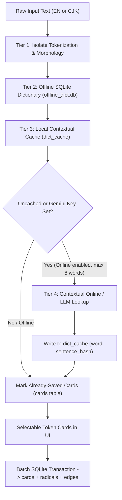

# VocabAnki — NLP Pipeline Architecture

This document explains how the **Tách từ NLP** (NLP Text Extractor) works in VocabAnki, from pasting raw text to saving FSRS flashcards with US/UK IPA pronunciations, surface-form Cloze deletions, and morpheme/radical links.

---

## 1. High-Level Multi-Tier Hybrid Pipeline

VocabAnki uses an **offline-first, 4-tier hybrid NLP pipeline** designed to run cleanly on both **Android** and **Flutter Web (SQLite WASM)** without blocking the UI thread:

---

## 2. Clean Architecture Layers

| Layer | File | Responsibility |
| :--- | :--- | :--- |
| **Presentation (UI)** | `lib/features/nlp_extractor/presentation/pages/nlp_extractor_page.dart` | Text input, Quick Paste/Clear, mode toggle (`EN-VI` / `CJK`), target deck selector, granular `.select()` token list, and error banner. |
| **Presentation (State)** | `lib/features/nlp_extractor/presentation/providers/nlp_extractor_provider.dart` | `NlpExtractorNotifier` manages `isAnalyzing`, `isSaving`, `tokens`, `selectedWords`, `lastElapsedMs`, and `try/catch` safety guards. |
| **Domain (Use Cases)** | `lib/features/nlp_extractor/domain/usecases/analyze_text_usecase.dart` `create_cards_from_tokens_usecase.dart` | Orchestrates text analysis and batch card creation. |
| **Data (Repository)** | `lib/features/nlp_extractor/data/repositories/nlp_extractor_repository_impl.dart` | Checks which extracted words already exist in `cards`, and persists selected tokens + morphemes inside a single SQLite transaction (with deck FK validation). |
| **Data (Engine)** | `lib/features/nlp_extractor/data/datasources/nlp_analyzer_datasource.dart` | Implements the 4-tier hybrid NLP engine (`HybridNlpAnalyzerDataSourceImpl`). |
| **Core Utilities** | `lib/core/database/offline_dictionary_database.dart` `lib/core/utils/cloze_masker.dart` | Read-only 205k-word SQLite dictionary loader and surface-form Cloze deletion masker. |

---

## 3. Step-by-Step Walkthrough

### Tier 1 — Background Isolate Tokenization, Phrasal Verbs, Context POS & Morphology
Executed via Flutter's `compute(_tokenizeAndDecomposeInIsolate, payload)` using the lightweight `assets/nlp/nlp_bundle.json` bundle (~208 KB):

1. **Sentence Splitting:**
   Splits input text on sentence boundaries (`(?<=[.!?。\n])\s+`) so every extracted token retains its exact source sentence for contextual learning.
2. **Pass 1 — Multi-Word Expressions (Phrasal Verbs) Sliding Window:**
   Before single-word tokenization, a 3-word and 2-word sliding window (including lemmatized head verbs like `gave up -> give up`, `looking forward to -> look forward to`) matches against the 8,600+ multi-word entries in `offline_dict.db`. Matched phrasal verbs (`look forward to`, `give up`, `take off`) are emitted as single cohesive flashcard tokens with phrase-level Cloze masking, and their constituent word indices are marked consumed.
3. **Pass 2 — Single-Word Tokenization & Context-Window POS Heuristic:**
   - **EN-VI mode:** Matches alphabetic tokens `[A-Za-z]{3,}`, filters stop words, deduplicates, and caps at **40 tokens per pass**.
   - **Context-Window POS (`_predictContextPos`):** Inspects `(prev2, prev1, next1)` in the sentence (`to` / modals / `began to` → `verb`; determiners `a/an/the` → `noun` or `adj` before content noun; degree adverbs → `adj`; `-ly` → `adv`).
   - **CJK mode:** Matches Hanzi/Kanji chunks `[\u4e00-\u9fff]{1,4}` (capped at 30) and decomposes characters into radicals/pinyin hints.
4. **Lemmatization (`_lemmatizeWord`):**
   - Checks the **5,500+ WordNet irregular lemma map** first (e.g., `ran -> run`, `phenomena -> phenomenon`, `better -> good`).
   - Falls back to rule-based inflection stripping (`-ies -> -y`, `-ied -> -y`, `-ves -> -f/-fe`, `-ing`, `-ed`, `-es`, `-s`), validating candidates against the offline dictionary.
5. **Validated Morphology & Compound Word Splitting (`_decomposeMorphology`):**
   - **Compound Words First:** Splits common English compounds & irregular plurals (`fishermen` / `fisherman` → `fish` + `man`) before affix/root extraction so compound boundaries are never sliced across.
   - **Stem-Validated Prefixes & Suffixes:** Prefixes (`startsWith`) and suffixes (`endsWith`) are only accepted when the remaining stem is a valid word/root (`wooden` → `wood + -en` valid; `green`, `dozen`, `fishermen` rejected).
   - **Boundary-Aligned Greco-Latin Roots:** No naive `word.contains(root)` matching; roots must align to the stripped `coreStem` boundary, preventing false positives like `fis[her]men` or `anot[her]`.
6. **Broad Learner IPA Normalization (`IpaNormalizer`):**
   Normalizes narrow IPA allophones (`ɫ -> l`, `ɹ -> r`) and strips redundant primary stress `ˈ` on single-syllable words (e.g., `/ˈɫɪft/` and `/lˈɪft/` → `/lɪft/`).
7. **Surface-Form Cloze Masking (`ClozeMasker.maskSentence`):**
   Masks the exact **surface form** (or multi-word phrasal verb) in the source sentence with `[...]`.

---

### Tier 2 — Dedicated Offline SQLite Dictionary (`assets/nlp/offline_dict.db`)
Managed by `OfflineDictionaryDatabase`:

- **Asset Size & Content:** ~18.7 MB pre-built SQLite database (`tool/build_offline_dict_sqlite.py`) containing **205,000+ English headwords** (including **8,633 multi-word/phrasal verb entries**), **104,700+ EN-VI definitions** (CC BY-SA 4.0), normalized **US (`ipa_us`) & UK (`ipa_uk`) IPA** from Open Dict Data, and irregular lemmas.
- **Read-Only Performance Pragmas (Native):** Applies `PRAGMA query_only = ON`, `PRAGMA mmap_size = 33554432` (32 MB mmap), and `PRAGMA cache_size = -8000` (8 MB page cache) on Android/native platforms.
- **POS-Prioritized Indexed Lookup:** Runs chunked primary-key queries (`WHERE word IN (...)` in chunks of 200) and prioritizes dictionary entries matching the Tier 1 predicted context POS.
- **Reliability Safeguards (Web & Mobile):** Uses a shared `_openingFuture` concurrency guard plus explicit timeouts (`12s` Web / `8s` native) so initialization never hangs.

---

### Tier 3 — Contextual Local SQLite Cache (`dict_cache`)
Before making any network request, `HybridNlpAnalyzerDataSourceImpl` queries the local `dict_cache` table in `vocab_anki_graph.db`:

- **Composite Key:** `(word, sentence_hash)` where `sentence_hash` is the first 12 hex characters of the MD5 hash of the normalized source sentence.
- **Why sentence-keyed?** Polysemous words (e.g., *"bank"* of a river vs. *"bank"* account) can store distinct context-specific Vietnamese meanings per sentence, with fallback to `(word, '')`.

---

### Tier 4 — Single-Batch Gemini LLM / Online Enrichment
Triggered only when `enableOnlineLookup` is enabled in Settings:

1. **Single-Batch Gemini JSON Array (Primary when API Key is set):**
   Combines up to **18** uncached/ambiguous tokens with their source sentences and predicted POS into **one single `POST` request** to `gemini-2.0-flash` requesting a structured JSON array:
   `[{"word": "...", "lemma": "...", "pos": "...", "meaning": "...", "root": "..."}]`.
   This dramatically reduces token usage and prevents HTTP `429` rate-limit errors. All returned items are persisted to `dict_cache` in a single `db.batch()` transaction.
2. **Fallback (No Gemini Key):**
   Queries `api.dictionaryapi.dev` + Google Translate GTX for up to 8 uncached words with strict per-word (`4s`) and overall (`6s`) timeouts.

---

## 4. Deck-Scoped Duplicate Detection & Batch Card Creation

1. **Deck-Scoped Duplicate Detection (`NlpExtractorRepositoryImpl.analyzeText`):**
   Queries `SELECT word FROM cards WHERE deck_id = ? AND word IN (...)` scoped to the currently selected target deck so users can see whether a word is already in that specific deck.
2. **Atomic Batch Transaction (`createCardsAndGraphNodes`):**
   - Verifies that the target `deck_id` exists in `decks` (falling back to the first available deck or auto-creating `default_deck` to prevent SQLite Foreign Key `code 787` errors).
   - Inserts all selected cards with `state = 0`, `is_suspended = 0`, and `next_review_at = now - 1000` using `ConflictAlgorithm.ignore` (preserving existing FSRS review history).
   - Links morphemes in `radicals` / `card_radical_edges`, while `DeckRepositoryImpl.getRelatedWordsByRadicals` filters strictly to meaningful ≥ 4-char Greco-Latin roots and compound stems.
